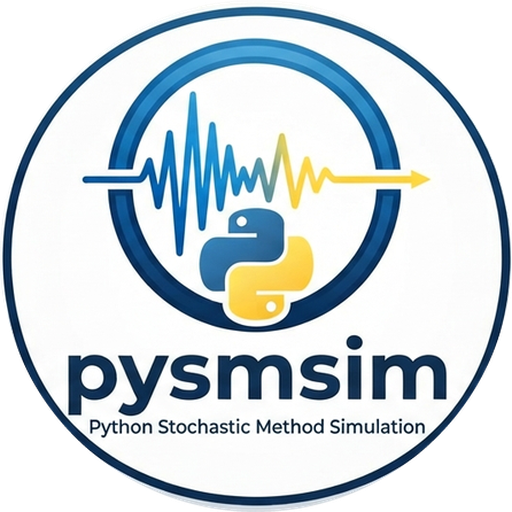

# pysmsim

<p align="center">
  
</p>

[](https://github.com/earthquake-ground-motion/pysmsim/actions/workflows/ci.yml)
[](https://earthquake-ground-motion.github.io/pysmsim/)

Pure Python Library Implementing the SMSIM Methodology of (Boore, 2003)

pysmsim is a Python port of David Boore's Fortran SMSIM programs (version
2023-03-03). It computes peak ground velocity and acceleration and
pseudo-spectral acceleration for grids of scenarios by the random-vibration
(RV) method, as SMSIM's `tmrsk_loop_rv_drvr` does, and by time-domain (TD)
simulations, as `tmrsk_loop_td_drvr` does, together with Fourier amplitude
spectra. The TD simulations also give peak displacement, Arias intensity
and significant durations.

## Documentation

The documentation is a MkDocs site built from `docs/`: installation, the
command line, the run-file format, a Python guide with snippets for running
each step (`fourier_spectrum`, `rv_motion`, `td_motion` and the loops) in a
notebook, the comparison with SMSIM and the API reference. To read it:

```bash
uv sync --extra docs
uv run mkdocs serve        # then open http://127.0.0.1:8000
```

Once GitHub Pages is switched on for the repository, the site is published
at https://earthquake-ground-motion.github.io/pysmsim/ from every push to
`main`.

## Installation

```bash
pip install -e .            # or: uv sync
pip install -e ".[dev]"     # with the test and lint tools
```

pysmsim needs Python 3.12 or later.

## Running from the command line

A run is described by one TOML file: the model parameters, the scenarios
(magnitudes, distances, periods, frequencies, kappa_0 and stress values)
and the output file. `examples/wna_bt15_example.toml` is SMSIM's own
example run.

```bash
pysmsim check examples/wna_bt15_example.toml          # validate and summarize
pysmsim run examples/wna_bt15_example.toml            # write the [output] file
pysmsim run examples/wna_bt15_example.toml -o results.h5
pysmsim run examples/wna_bt15_example.toml -o results.col --fortran-compat
pysmsim run examples/wna_bt15_example.toml --td -o results.h5   # also TD
```

`--td` adds `[td] nsims` time-domain simulations of every scenario (800 in
the example), which takes much longer than the RV method; `--no-rv` leaves
the RV method out. `--td-series [NSIMS]` also writes the acceleration
series (all simulations, or the first NSIMS of each scenario) to the HDF5
output, in `/td/series`: `times` (s, from 0) and `acceleration`, an array
of shape (simulations, time steps, scenarios), the whole series in 32-bit
floats (`--series-precision 64` for 64-bit). `--series-tolerance 1e-4`
stores each series only from where it first rises above 1e-4 of its peak
to where it last falls below it, about a third of the size; the rest is
NaN and takes no space. The files are large: 800 simulations of 10,000
points take 32 MB per scenario in 32-bit. `pysmsim.io.hdf5.read_td_series`
reads them back.

The output format follows the suffix given with `-o`, or `--format`:

| Format | Contents |
| --- | --- |
| `csv`, `parquet` | One row per scenario: the scenario columns, then `pgv` (cm/s), `pga` and `psa(T)` (cm/s²), the TD means with the prefix `td_` (`td_pga`, `td_pgd` in cm, `td_arias` in cm/s, `td_dur_75_05` in s, `td_psa(T)`...) and `fas(f)` (cm/s) |
| `hdf5` | The scenario, FAS, RV and TD tables in one file, with the arithmetic and geometric means and spreads of the TD simulations and the run file stored in it |
| `col` | SMSIM's `.col` layout of the RV results, one row per scenario and measure, for comparison with the Fortran |

`--workers N` shares the scenarios among N processes (0: one per CPU)
and gives the same results as one. Starting the processes takes a second
or two, so it pays off for the RV method on large grids; the TD method
already uses every core. `python examples/benchmark.py` times the loops of
a run file.

`--fortran-compat` reproduces SMSIM's behaviour where pysmsim deliberately
differs from it (see `CLAUDE.md`). `pysmsim --help` and
`pysmsim run --help` list every option.

### One scenario in detail

`pysmsim scenario` computes one magnitude and distance with the model,
oscillator periods, damping and frequencies of a run file, and prints every
detail, as SMSIM's `gm_rv_drvr`, `gm_td_drvr` and `FAS_DRVR` do:

```bash
pysmsim scenario examples/wna_bt15_example.toml -m 6 -r 20
pysmsim scenario examples/wna_bt15_example.toml -m 6 --rjb 15 --td -o m6_rjb15
pysmsim scenario examples/wna_bt15_example.toml -m 6 -r 20 --td --series 1 -o m6
```

The distance is the rupture distance (`-r`), or the Joyner-Boore distance
(`--rjb`), converted to Rrup as the run file's `[scenarios]` says. The RV
results are PGD, PGV, PGA, the Arias intensity and PSA at each period, with
their moments, durations and peak factors. `--td` adds the means, standard
errors, geometric means and factors of `[td] nsims` simulations (or
`--nsims N`), and the Fourier spectra and their factors come when the run
file gives `[scenarios] frequencies`. With `-o DIR`, the tables are also
written as CSV files in DIR: `rv.csv`, `td.csv`, `fas.csv` and, with
`--series K`, `td_series.csv`, the acceleration (cm/s²), velocity (cm/s)
and displacement (cm) of simulation K.

### Converting SMSIM input files

`pysmsim convert` turns an SMSIM parameter file (the format of SMSIM
2023-03-03, dated 02/25/21) and, optionally, a `tmrsk_loop_rv_drvr` or
`tmrsk_loop_td_drvr` control file into a run file:

```bash
pysmsim convert model.params tmrsk_loop_rv_drvr.ctl -o run.toml
pysmsim convert model.params > run.toml   # example scenarios to edit
```

Where SMSIM would behave differently from pysmsim with these inputs (for
example the stress model of sources 2, 11 and 12, or a low-cut `nslope`
that SMSIM rounds), the converter prints a note and writes it at the top
of the run file. An existing `-o` file is replaced only with `--force`.

## Using it from Python

```python
from pysmsim.io.config import load_config
from pysmsim.drivers.run import run
from pysmsim.io.hdf5 import write_hdf5

config = load_config("examples/wna_bt15_example.toml")
result = run(config.params, config.scenarios)
result.rv[["pgv", "pga"]]      # psa(T) columns follow
write_hdf5(result, "results.h5")

from pysmsim.td.gm_td import td_motion

sims = td_motion(config.params, 6.0, 20.0, [0.1, 1.0], nsims=20, keep_series=True)
sims.pga, sims.psa, sims.acc   # one value (or series) per simulation
sims.statistics("pga")         # mean, std, geometric mean and factor
```

For one scenario, `pysmsim.drivers.single` gives every intermediate
quantity:

```python
import numpy as np
from pysmsim.drivers.single import fas_scenario, rv_scenario, td_scenario

rv = rv_scenario(config.params, 6.0, 20.0, [0.1, 1.0])   # Rrup = 20 km
rv.pga.peak, rv.arias, rv.table()   # one row per measure, all quantities
td = td_scenario(config.params, 6.0, 20.0, [0.1, 1.0], keep_series=True)
td.table(), td.series(0)            # averages; time, acc, vel, dis
fas_scenario(config.params, 6.0, 20.0, np.logspace(-2, 2, 41), [0.1, 1.0])
```

The TD simulations draw their noise from NumPy's random-number generator,
seeded with `[td] seed`, so a run gives the same results every time, but not
the same as SMSIM's: their means agree within the scatter of the
simulations.

Every step (source spectrum, path terms, spectral moments, peak factors,
window, noise, one time series, oscillator response) is a public function that can be called on its own; see the docstrings.

## Licence

GNU General Public License v3.0; see `LICENSE`.
