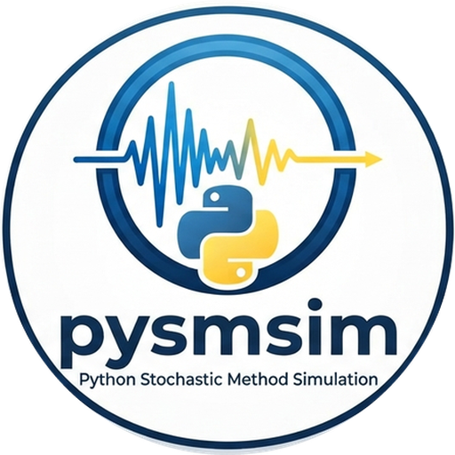

# pysmsim

{ .home-logo }

pysmsim is a Python port of David Boore's Fortran SMSIM programs (version
2023-03-03) for the stochastic simulation of earthquake ground motion
(Boore, 2003). From a model of the Fourier amplitude spectrum (source, path
and site) it computes:

- **Fourier amplitude spectra** of ground motion and of oscillator response,
  with each factor of the spectrum (SMSIM's `FAS_DRVR` and
  `fmrsk_loop_fas_drvr`);
- **random-vibration (RV)** peak motions: PGV, PGA, PGD, Arias intensity
  and pseudo-spectral acceleration, from spectral moments and peak factors
  (`gm_rv_drvr` and `tmrsk_loop_rv_drvr`);
- **time-domain (TD)** simulations: windowed white noise shaped by the
  spectrum, with the PGA, PGV, PGD, Arias intensity, significant durations
  and PSA of every simulation, and their means and spreads (`gm_td_drvr`
  and `tmrsk_loop_td_drvr`).

It reproduces SMSIM to the digits SMSIM prints, except where SMSIM has a
known quirk or limited accuracy (see [Comparison with SMSIM](smsim.md)).

## Three ways to use it

**From the command line**, with a TOML run file that holds the model and
the scenarios:

```bash
pysmsim run examples/wna_bt15_example.toml -o results.h5
pysmsim scenario examples/wna_bt15_example.toml -m 6 -r 20
```

See [Command line](cli.md) and [Run files](run-files.md).

**From Python, a grid at a time**, with the loop drivers:

```python
from pysmsim.io.config import load_config
from pysmsim.drivers.run import run

config = load_config("examples/wna_bt15_example.toml")
result = run(config.params, config.scenarios)
result.rv          # one row per scenario: pgv, pga, psa(T)...
```

**From Python, one step at a time**, for example in a Jupyter notebook.
Every physics step (the source spectrum, a spreading factor, the spectral
moments, a peak factor, one time series, an oscillator response) is a
public function that takes plain arguments and returns NumPy arrays or a
small dataclass:

```python
import numpy as np
from pysmsim.spectrum.fas import fourier_spectrum
from pysmsim.rv.gm_rv import rv_motion
from pysmsim.spectrum.response import Oscillator
from pysmsim.td.gm_td import td_motion

f = np.logspace(-2, 2, 100)
fas = fourier_spectrum(f, config.params, 6.0, 20.0)       # M 6, Rrup 20 km
psa = rv_motion(config.params, 6.0, 20.0, Oscillator(period=1.0)).psa
sims = td_motion(config.params, 6.0, 20.0, [0.1, 1.0], nsims=100)
```

The [Python guide](guide/index.md) shows how to run each of these on its
own and as part of the loops.

## Units

pysmsim uses SMSIM's units: cgs (cm, s, g/cm³), with distances in km,
stress in bars, frequencies in Hz and g = 981 cm/s². PGA and PSA are in
cm/s², PGV in cm/s, PGD in cm, Arias intensity in cm/s and the Fourier
acceleration spectrum in cm/s.

## Licence

GNU General Public License v3.0.
